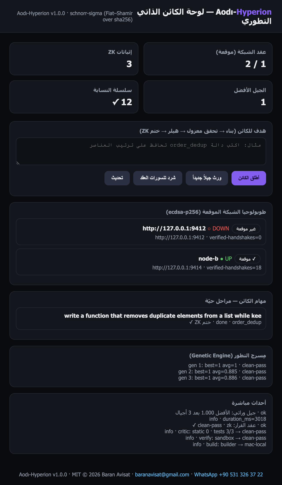

# Aodı-Hyperion

**The Zero-Knowledge Self-Evolving Neural Organism & Cryptographic Mesh**

A machine-local organism that builds code on your own Ollama fleet, verifies
every candidate in an isolated sandbox with property tests, seals each verdict
with a **real non-interactive Schnorr zero-knowledge proof**, evolves its own
executable genomes through a **real genetic engine**, shards **real matrix
math** across your devices over a signature-verified gossip mesh — zero cloud,
zero paid APIs, zero bytes leaving your machines.

| Layer | Language | Role |
|---|---|---|
| `mesh/` | Go 1.21 (stdlib) | signed gossip: ECDSA P-256 identities, verified heartbeats |
| `core/` | Python 3.8+ (stdlib only) | organism swarm · genetic engine · ZK attestations · tensor sharding · lineage chain · API |
| `relay/` | Node 18+ (zero npm) | Telegram Bot notifications |
| `dashboard/` | HTML/JS (zero deps) | Arabic RTL evolution board |
| `ledger-solidity/` | Solidity | optional public anchor for the lineage head |

- **License:** MIT © 2026 Baran Avisat
- **Support:** baranavisat@gmail.com · WhatsApp +90 531 326 37 22 (wa.me/905313263722)
- **100% free stack:** Ollama (local) · SQLite · Go/Python/Node stdlibs — no pip, no npm, no Docker

## The four honest pillars

1. **ZK-verified verdicts (real cryptography).** Every build verdict is bound
   to the organism's attestor identity with a non-interactive Schnorr sigma
   proof (Fiat–Shamir over sha256) inside the RFC 3526 2048-bit MODP group.
   Anyone can verify offline: `g^s ?= r·y^c`. Identity stays hidden; forgery is
   computationally infeasible. Honest scope: this is a genuine zero-knowledge
   protocol — **not** a general-purpose SNARK compiler (stdlib-only discipline).

2. **Self-evolution (real genetics).** The engine keeps a population of
   executable genomes (actual Python source), applies bounded mutation
   operators, scores them by isolated-sandbox property tests + static
   heuristics, kills the weakest, crosses elites, and seals every generation
   into the append-only lineage chain. Example from the recorded demo:
   best fitness reaches 1.000 (clean-pass) within 3 generations at 0.37 s
total (every generation sealed).

3. **Signed gossip mesh (real authenticity).** Each node holds a persistent
   ECDSA P-256 key; every `/hy/mesh/state` snapshot is signed and verified on
   every heartbeat round. Unverified snapshots never enter the node table.
   Honest scope: post-quantum lattice signing has no stdlib implementation —
   the protocol keeps a typedef-level slot for it (see `docs/WHITEPAPER.md`).

4. **Heterogeneous tensor sharding (real math).** `C = A*B` is split into K*K
   blocks; each block is computed by a different registered worker (remote
   HTTP or callable), then reduced and verified against a local reference —
   honest scope: numerical tensor math over the fleet, **not** LLM weight
   partitioning (that needs another executor ecosystem; never faked here).

## Recorded live numbers

Full dataset with provenance in [BENCHMARKS.md](BENCHMARKS.md). From the
dashboard capture — every row is a recorded response or a measured wall-clock
sample:

| Metric | Value |
|---|---|
| Schnorr prove / verify (2048-bit, pure math, avg of 10) | **27.2 ms / 31.9 ms** |
| Organism task (warm brain) | **done in 3.0 s** → sandbox 44 ms → clean-pass → **zk-sealed** |
| Evolution (3 generations x pop 5) | best **1.000 clean-pass** in 0.37 s, every generation lineage-sealed |
| Sharded matmul 24x24 via remote HTTP worker | 4 blocks / 9 ms → **verified** against exact reference |
| Signed mesh | ECDSA P-256 verified heartbeats — **18 verified handshakes** in the demo |
| Lineage chain | **12 links ✓** tamper-evident; offline `verify-attest` = **VALID** |
| Verification sandbox | `python -I` + rlimits (AS/CPU/NPROC/CORE=0) + process-group kill |



## Run in 60 seconds (no pip/npm)

```bash
# 1) mesh daemon (Go stdlib, ECDSA-signed heartbeats)
cd mesh && go build -o ../bin/hy-mesh . && ./../bin/hy-mesh

# 2) organism core + dashboard (Python stdlib)
python3 core/server.py --port 9412
open http://127.0.0.1:9412/
```

Then drive it:

```bash
python3 core/cli.py nodes add mac-local http://127.0.0.1:11434 gpu
python3 core/cli.py run "write a function that dedups a list preserving order" order_dedup
python3 core/cli.py evolve 3 5
python3 core/cli.py attest README.md first-seal
python3 core/cli.py lineage
```

Or over HTTP: `POST /api/organism/run`, `/api/evolve`, `/api/tensor`,
`/api/attest`; read `/api/lineage`, `/api/attestations`, `/api/events`.

## Tests

```bash
python3 tests/test_hyperion.py -v    # offline: zk · genetics · tensor · sandbox · chain
node --check relay/relay.js
cd mesh && gofmt -w . && go vet ./... && go build ./...
```

## Honest disclosure

- "Self-evolving organism" = evolutionary optimization of executable code
  genomes and execution genes. It does not mutate neural-network weights.
- The ZK layer is identity/attestation binding (sigma protocol), not rich
  circuit-level proofs; rich ZK would require external libraries, which the
  stdlib-first discipline forbids.
- Mesh transport privacy rides on your tailnet; authenticy (not privacy) is
  carried by ECDSA signatures — both are documented, nothing is claimed twice.
- The lineage chain is tamper-evident, not distributed consensus; anchor its
  head publicly via the optional `HyperionLedger.sol` contract.

© 2026 Baran Avisat · MIT · BTC `bc1q8dhtdrndxsl70e97t8grydfe6pjue37zrhzf6c` · USDT-TRC20 `TLWdTjqqogkXNEXGiPWsGdjFP6ioycxeWW`
